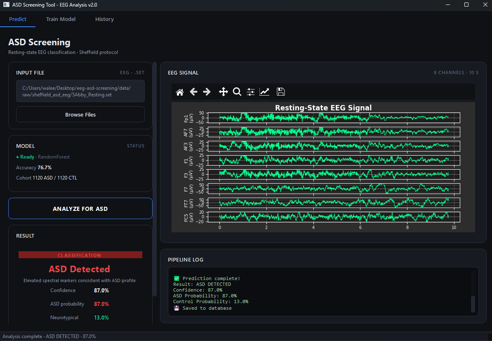
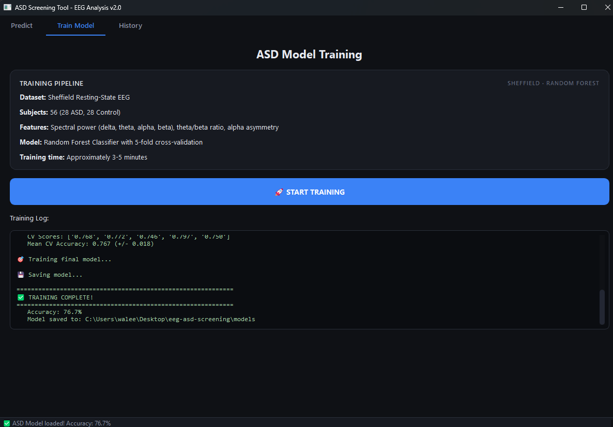
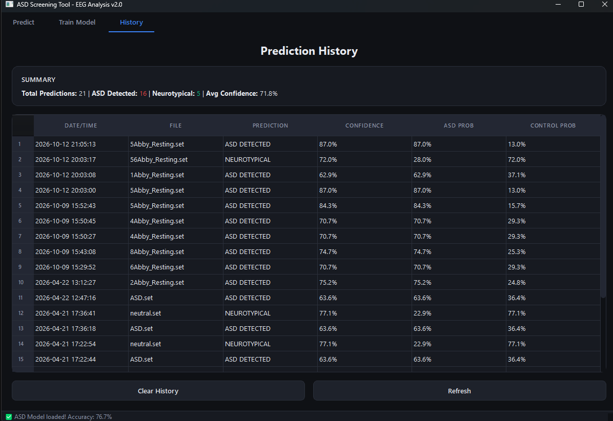
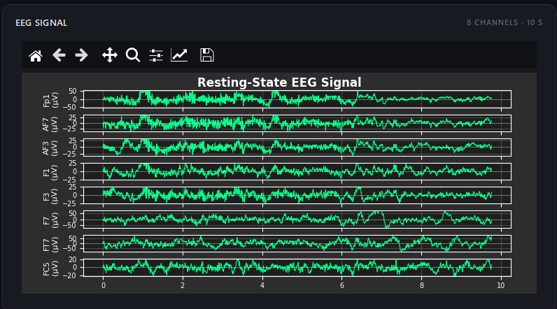
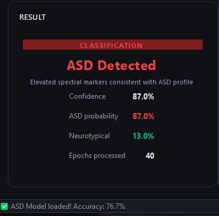

# EEG ASD Screening Tool

A desktop application that classifies resting-state EEG recordings as
**ASD (Autism Spectrum Disorder)** or **neurotypical** using spectral
features extracted from the signal and a Random Forest classifier.

Built with Python, PySide6, MNE-Python, and scikit-learn.


---

## Table of Contents

- [Overview](#overview)
- [Features](#features)
- [Screenshots](#screenshots)
- [Requirements](#requirements)
- [Installation](#installation)
- [Dataset Setup](#dataset-setup)
- [Usage](#usage)
- [Project Structure](#project-structure)
- [How It Works](#how-it-works)
- [Model Performance](#model-performance)
- [Troubleshooting](#troubleshooting)
- [Development](#development)
- [Building a Standalone Executable](#building-a-standalone-executable)
- [License](#license)
- [Acknowledgments](#acknowledgments)

---

## Overview

This tool provides an end-to-end pipeline for ASD screening from
resting-state EEG data. It includes:

- A **training workflow** that loads the Sheffield dataset, extracts
  spectral features, trains a Random Forest classifier, and persists
  the model to disk.
- A **prediction workflow** that loads a single `.set` EEG file, runs
  it through the same preprocessing pipeline used during training, and
  outputs a classification with confidence scores.
- A **local history** of all predictions stored in a SQLite database
  so results can be reviewed later.

The application is built around a single shared preprocessing pipeline
(`src/core/preprocessing/pipeline.py`) to guarantee that the model sees
identical feature distributions during training and inference — a
common source of silent errors in EEG-based ML projects.

---

## Features

### Training
- Loads 56-subject Sheffield dataset (28 ASD, 28 Control)
- Segments continuous EEG into fixed-length epochs (2 s each)
- Applies a 1–50 Hz bandpass filter
- Extracts 19 spectral features per epoch:
  - Mean/std/max power in delta, theta, alpha, beta bands
  - Theta/Beta ratio
  - Alpha/Theta ratio
  - Frontal theta power
  - Global mean, std, max amplitude
- Trains a Random Forest (100 trees, max depth 10)
- 5-fold stratified cross-validation
- Saves model, scaler, and metadata to `models/`

### Prediction
- Loads any EEGLAB `.set` file
- Applies the exact same filter + epoch + feature pipeline as training
- Outputs ASD vs. Neurotypical classification
- Reports per-class confidence and probability
- Plots the first 8 channels × 10 s of EEG
- Saves result to local SQLite database

### UI
- Three-tab layout: **Predict**, **Train Model**, **History**
- Dark clinical theme with design tokens centralized in `theme.py`
- Background threads for both training and prediction
  (UI never freezes)
- Live log console for every stage of the pipeline
- Result card with color-coded verdict (red = ASD, green = neurotypical)
- Prediction history table with summary statistics

---
## Screenshots

### Prediction tab


### Training tab


### History tab


### EEG signal plot


### Result card


---
## Requirements

### Software
- **Python 3.10 or newer** (tested on 3.11)
- **pip** (bundled with Python)
- **Git** (to clone the repo)
- **Windows 10/11**, **macOS 12+**, or **Linux** (tested on Ubuntu 22.04)

### Python dependencies

Installed automatically via `pip install -r requirements.txt`. Key packages:

| Package | Purpose |
|---------|---------|
| `PySide6` | Qt6 desktop UI framework |
| `mne` | EEG/MEG data loading and signal processing |
| `numpy` | Numerical arrays |
| `scipy` | Signal processing (Welch PSD) |
| `scikit-learn` | Random Forest, cross-validation, scaling |
| `matplotlib` | EEG plotting widget |
| `joblib` | Model serialization |
| `pandas` | Tabular manipulation (transitive) |
| `seaborn` | Figure generation for paper/reports |

---
## Installation

### 1. Clone the repository

```bash
git clone https://github.com/KnightMaresss/eeg-asd-screening.git
cd eeg-asd-screening
```

### 2. Create a virtual environment

**Windows (PowerShell):**

```powershell
python -m venv venv
.\venv\Scripts\Activate.ps1
```

If PowerShell blocks the activation script:

```powershell
Set-ExecutionPolicy -Scope CurrentUser -ExecutionPolicy RemoteSigned
```

**macOS / Linux:**

```bash
python3 -m venv venv
source venv/bin/activate
```

### 3. Install dependencies

```bash
pip install --upgrade pip
pip install -r requirements.txt
```

This takes ~2–5 minutes the first time (MNE and scikit-learn are large).

### 4. Verify installation

```bash
python -c "import mne, PySide6, sklearn; print('ok')"
```

Expected output: `ok`

---
## Dataset Setup

The Sheffield dataset is **not** included in this repository. You must
provide it manually.

### Getting the dataset

The dataset is openly available on the University of Sheffield's
ORDAs repository:

**[EEG Data for "Electrophysiological signatures of brain aging in
autism spectrum disorder"](https://orda.shef.ac.uk/articles/dataset/EEG_Data_for_Electrophysiological_signatures_of_brain_aging_in_autism_spectrum_disorder_/16840351)**

- Authors: Elizabeth Milne et al.
- Published: 2021-12-05
- Participants: 28 ASD + 28 neurotypical controls (ages 18–68)
- Paradigm: 2.5 min eyes-closed resting state
- Hardware: Biosemi ActiveTwo EEG system
- Format: EEGLAB `.set` + `.fdt` pairs
- License: Open access (per the ORDA listing)
- Reference publication: Dickinson, Jeste & Milne,
  *"Electrophysiological signatures of brain aging in autism spectrum
  disorder"*

Download the archive from ORDA, extract it, and place the `.set`/`.fdt`
files under `data/raw/sheffield_asd_eeg/` (see below).

**Note on licensing:** The ORDA listing states the data can be shared
openly, but always confirm the exact terms on the ORDA page before
redistributing. Do **not** commit the raw data to this repository —
keep it under `data/raw/`, which is gitignored.

### Placing the dataset

Place the `.set` and `.fdt` files under:

```
data/raw/sheffield_asd_eeg/
```

Expected structure:

```
data/
└── raw/
    └── sheffield_asd_eeg/
        ├── 1Abby_Resting.set
        ├── 1Abby_Resting.fdt
        ├── 2Abby_Resting.set
        ├── 2Abby_Resting.fdt
        ├── ...
        ├── 56<name>_Resting.set
        └── 56<name>_Resting.fdt
```

**Important:** Every `.set` file needs a matching `.fdt` file with the
same stem. The loader silently skips any `.set` without its `.fdt`.

### Label convention

Subjects are labeled by subject number as parsed from the filename:

- **1–28** → ASD
- **29–56** → Control

If your dataset uses a different convention, edit
`SheffieldLoader.get_subject_label()` in
`src/core/preprocessing/loader.py`.

---

## Usage

### Launch the application

```bash
python run.py
```

Or, equivalently:

```bash
python -m src.gui.main_window
```

### First run

On first launch, the Predict tab's **Model status** card will show
**"● Not trained"**. You must train the model before you can predict.

### Train the model

1. Go to the **Train Model** tab.
2. Click **🚀 START TRAINING**.
3. Watch the live log as it:
   - Loads ~2,240 epochs across 56 subjects
   - Extracts 19 features per epoch (~42,000 feature values total)
   - Runs 5-fold cross-validation
   - Trains the final Random Forest
   - Saves model artifacts to `models/`
4. Expected runtime: **3–5 minutes** on a modern CPU.
5. On completion, the status bar shows the CV accuracy and the Predict
   tab's model card flips to **"● Ready"**.

### Predict from an EEG file

1. Go to the **Predict** tab.
2. Click **Browse Files** and select any `.set` file.
3. Click **ANALYZE FOR ASD**.
4. Watch the pipeline log:
   - Loading model
   - Loading EEG file
   - Filtering (1–50 Hz)
   - Segmenting into 2 s epochs
   - Extracting features
   - Running prediction
5. The result card appears with:
   - Classification (ASD Detected / Neurotypical)
   - Confidence percentage
   - Per-class probabilities
   - Number of epochs processed
6. The EEG plot renders the first 8 channels.
7. The result is saved to the History tab automatically.

### Review history

1. Go to the **History** tab.
2. View a summary (total predictions, ASD count, control count, average
   confidence) and the full table of past runs.
3. Click **Refresh** to reload from the database.
4. Click **Clear History** to wipe all records (requires confirmation).

---

## Project Structure

```
eeg-asd-screening/
├── src/
│   ├── __init__.py
│   ├── core/
│   │   ├── database/
│   │   │   └── db_manager.py         # SQLite prediction history
│   │   ├── features/
│   │   │   └── asd_features.py       # Spectral feature extraction
│   │   ├── models/
│   │   │   └── model_manager.py      # Save/load joblib artifacts
│   │   └── preprocessing/
│   │       ├── loader.py             # Sheffield dataset loader
│   │       └── pipeline.py           # Shared filter+epoch pipeline
│   ├── gui/
│   │   ├── main_window.py            # Top-level window + tab wiring
│   │   ├── theme.py                  # Design tokens + global QSS
│   │   ├── threads.py                # QThread workers
│   │   └── widgets/
│   │       └── eeg_plot_widget.py    # Matplotlib EEG plot
│   └── utils/
│       └── config.py                 # Paths + constants
├── data/
│   ├── raw/                          # (gitignored) raw EEG files
│   ├── processed/                    # (gitignored) derived data
│   └── database/                     # (gitignored) predictions.db
├── models/                           # (gitignored) trained model files
├── assets/
│   └── screenshots/                  # Screenshots used in this README
├── notebooks/
│   └── 01_explore_dataset.ipynb      # Data exploration
├── run.py                            # Entry point
├── generate_figures.py               # Regenerate paper figures
├── ASD_Screening_Tool.spec           # PyInstaller spec
├── hook-mne.py                       # PyInstaller MNE hook
├── requirements.txt
└── README.md
```

---

## How It Works

### Preprocessing pipeline

Both training and prediction use the exact same pipeline
(`src/core/preprocessing/pipeline.py`):

```
Raw .set file
  ↓ mne.io.read_raw_eeglab
Raw object
  ↓ filter(1–50 Hz, FIR)
Filtered raw
  ↓ make_fixed_length_events (2 s)
Events
  ↓ mne.Epochs
Epochs (n × channels × 1024 samples)
  ↓ cap at 40 per subject
Final epoch set
```

This shared pipeline is intentional. It prevents a class of silent bugs
where training and inference preprocess data differently, causing the
model to see out-of-distribution inputs at prediction time.

### Feature extraction

For each epoch, 19 features are computed:

| Feature | Description |
|---------|-------------|
| `mean_delta_power` | Average delta-band (1–4 Hz) power across channels |
| `std_delta_power` | Standard deviation of delta power across channels |
| `max_delta_power` | Maximum delta power |
| *(same for theta, alpha, beta)* | 12 features total |
| `theta_beta_ratio` | Key ASD biomarker from the literature |
| `alpha_theta_ratio` | Secondary ratio |
| `frontal_theta_mean` | Theta power from frontal channels only |
| `global_mean` | Mean amplitude across the epoch |
| `global_std` | Standard deviation of the epoch |
| `global_max` | Maximum absolute amplitude |

### Model

- **Algorithm:** Random Forest Classifier
- **Hyperparameters:** 100 estimators, max depth 10, `n_jobs=-1`
- **Validation:** 5-fold stratified cross-validation
- **Input:** 19 features per epoch, standardized via `StandardScaler`
- **Output:** Binary classification (ASD vs. Control)

### Decision rule

The model outputs per-epoch probabilities. The final classification
uses the **mean ASD probability across all epochs** in the file. If
`mean(ASD prob) > 0.5`, the file is classified as ASD.

---

## Model Performance

Results from the 5-fold cross-validation on the Sheffield dataset:

| Metric | Value |
|--------|-------|
| Mean CV Accuracy | ~77.6% |
| Fold accuracies | 78.1%, 76.1%, 76.8%, 81.5%, 75.7% |
| Samples | ~2,240 epochs |
| Features | 19 |
| Subjects | 56 (28 ASD / 28 Control) |

**Note:** These are epoch-level metrics, not subject-level. Real-world
clinical screening would aggregate predictions per subject.

Figure regeneration script: `python generate_figures.py` produces:

- `cv_boxplot.png` — cross-validation distribution
- `feature_importance.png` — top discriminative features
- `confusion_matrix.png` — per-class errors
- `metrics_bar.png` — accuracy / precision / recall / F1

---

## Troubleshooting

### "No features extracted!" during training

The dataset wasn't found. Check:

1. `data/raw/sheffield_asd_eeg/` exists
2. It contains pairs of `.set` and `.fdt` files
3. Verify with:

```bash
python -c "
from pathlib import Path
root = Path('data/raw/sheffield_asd_eeg')
print('.set:', len(list(root.glob('*.set'))))
print('.fdt:', len(list(root.glob('*.fdt'))))
"
```

Both counts should be 56.

### "RuntimeError: Internal C++ object already deleted"

This was a known bug in earlier versions caused by `deleteLater` on
`QThread` before the Python wrapper went out of scope. It's fixed.
If you see it, ensure you're on the latest commit.

### App launches but the Predict tab shows "● Not trained"

Expected on first run. Go to **Train Model** and click **START TRAINING**.

### Predictions look wrong after refactoring preprocessing

If you change `src/core/preprocessing/pipeline.py` in any way, you
**must retrain** the model. The model is only valid for the exact
preprocessing it was trained on.

Delete `models/*.joblib` and retrain.

### PySide6 import fails on Linux

Install the system Qt libraries:

```bash
sudo apt install libgl1 libegl1 libxkbcommon-x11-0
```

### `raw.filter` is very slow

MNE's FIR filtering is CPU-bound. Training filters 56 files. On a
slow machine this can take a few minutes. Reduce
`MAX_EPOCHS_PER_SUBJECT` in `src/utils/config.py` if you want faster
iteration.

---

## Development

### Running from source

```bash
python run.py
```

The entry point adds `src/` to `sys.path` automatically.

### Adding features

- **New spectral feature:** edit `src/core/features/asd_features.py`,
  add to `extract_features()`. Feature names are derived dynamically,
  so the model metadata will pick them up.
- **New UI tab:** add a method in `src/gui/main_window.py` returning a
  `QWidget`, then `self.tabs.addTab(...)` in `init_ui()`.
- **New preprocessing step:** edit
  `src/core/preprocessing/pipeline.py`. **Retrain the model** after.

### Constants and paths

Everything tunable lives in `src/utils/config.py`:

```python
EPOCH_DURATION_S = 2.0
MAX_EPOCHS_PER_SUBJECT = 40
BANDPASS_LOW_HZ = 1.0
BANDPASS_HIGH_HZ = 50.0
CV_FOLDS = 5
RF_N_ESTIMATORS = 100
RF_MAX_DEPTH = 10
RANDOM_STATE = 42
```

### Tests

There's no test suite yet. If you add one, put it under `tests/`:

```bash
pytest
```

### Regenerating figures

```bash
python generate_figures.py
```

Outputs four PNG files in the project root. These are gitignored —
commit the script, not the output.

---

## Building a Standalone Executable

The repo includes a PyInstaller spec file. To build a Windows `.exe`:

### 1. Install PyInstaller

```bash
pip install pyinstaller
```

### 2. Build

```bash
pyinstaller ASD_Screening_Tool.spec
```

### 3. Output

- `dist/ASD_Screening_Tool/ASD_Screening_Tool.exe`
- Double-click to run — no Python installation required on the target
  machine.

The `hook-mne.py` file ensures MNE's data files and submodules are
bundled correctly.

**Note:** The trained model (`models/*.joblib`) is copied into the
bundle by the spec file. You must train the model before building, or
the exe will launch with no model available.

---

## License

This project is licensed under the **MIT License** — see the
[LICENSE](LICENSE) file for details.
---

## Acknowledgments

- **Sheffield Resting-State EEG Dataset** — original data collection
  and curation by the dataset authors.
- **MNE-Python** — open-source EEG/MEG analysis in Python.
- **scikit-learn** — machine learning toolkit.
- **PySide6 / Qt** — cross-platform GUI framework.

---

## Citation

If you use this tool in academic work, please cite the Sheffield
dataset and any relevant papers. Add your own citation here if you
publish results based on this tool.

---

## 👤 Author

**Waleed (KnightMares)**

- GitHub: [@KnightMaresss](https://github.com/KnightMaresss)
- Email: [waleedalmaqtari10@gmail.com](mailto:waleedalmaqtari10@gmail.com)

**Repository:** [github.com/KnightMaresss/eeg-asd-screening](https://github.com/KnightMaresss/eeg-asd-screening)

For questions or issues, please [open a GitHub Issue](https://github.com/KnightMaresss/eeg-asd-screening/issues).


